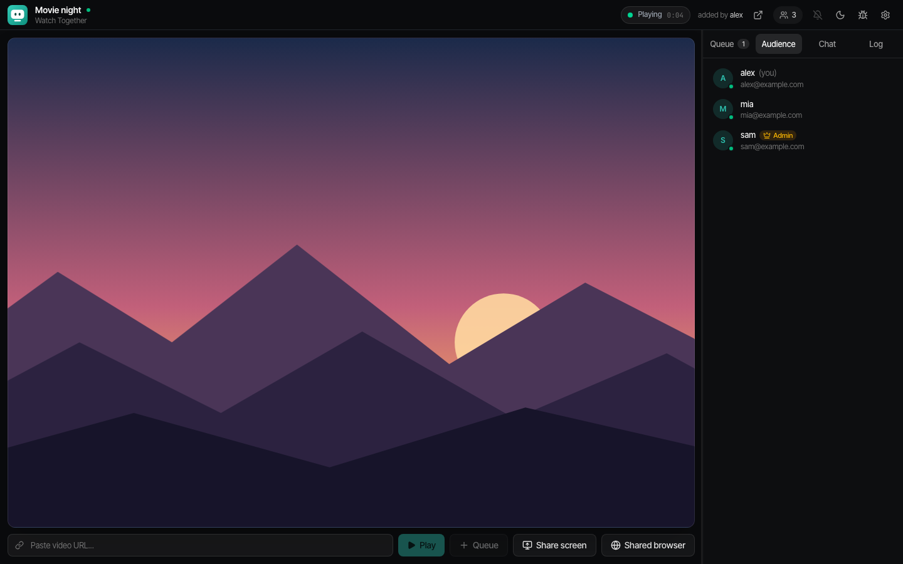
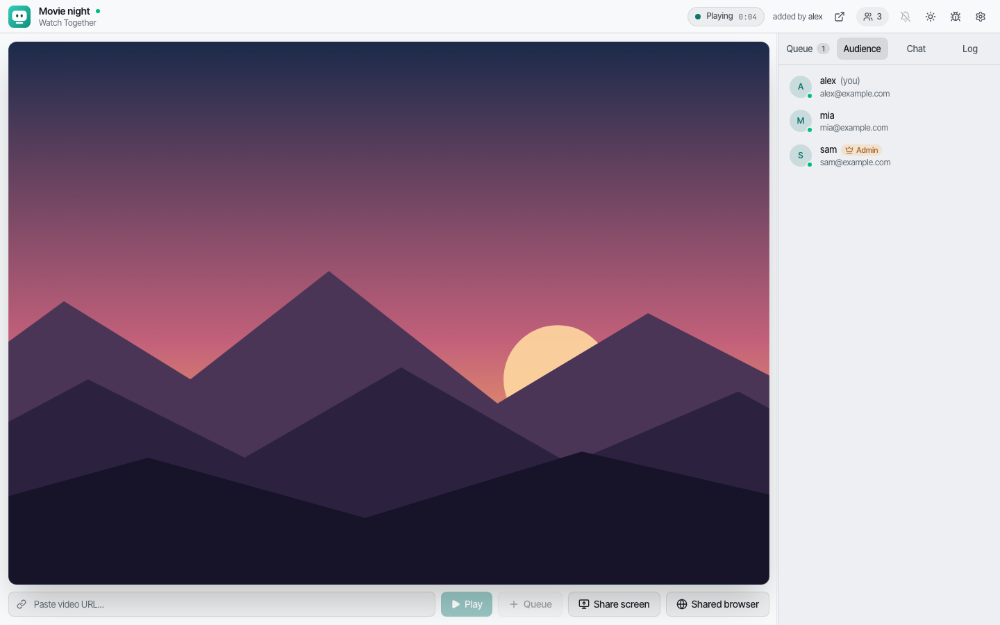
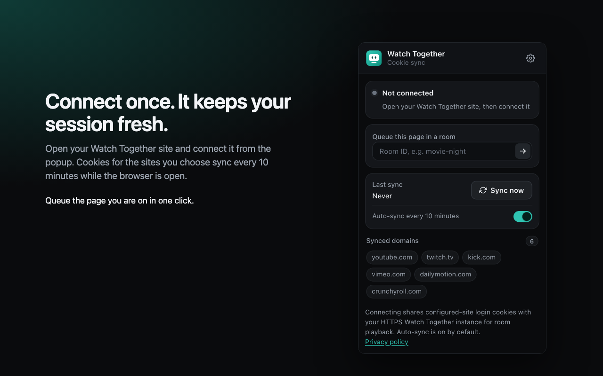

# Watch Together

<p align="center">
  
</p>

<p align="center">
  <b>Press play once. Everyone's watching.</b><br>
  A watch party you run yourself, for YouTube, Twitch, Kick and 1800+ other sites.<br>
  Every browser in the room plays on one clock, within half a second of each other.
</p>

<p align="center">
  <a href="https://watch-together.renner.dev/"><b>Website</b></a> ·
  <a href="https://watch-together.renner.dev/docs/">Documentation</a> ·
  <a href="https://chromewebstore.google.com/detail/watch-together-cookie-syn/beonlkadfoclpnfigngknbjfoifibagn">Browser extension</a> ·
  <a href="https://watch-together.renner.dev/privacy/">Privacy</a> ·
  <a href="LICENSE">MIT license</a>
</p>

<p align="center">
  <a href="https://github.com/rennerdo30/watch-together/actions/workflows/ci.yml"></a>
  <a href="https://github.com/rennerdo30/watch-together/actions/workflows/codeql.yml"></a>
</p>



## Why Watch Together

Hosted watch parties play what their own player can, from the few sites they
support, with whoever happens to be on their servers. Watch Together is yours:
a link from almost any site plays for the whole room, rooms are just links, and
only the people you let in get in.

Two things make it more than a shared player. **Sync is the server's job**: it
holds the room's position, sends it every five seconds, and each browser
corrects itself quietly, speeding up by five percent when a little behind and
seeking only when more than three seconds off. And **one signed-in member is
enough**: the browser extension lends their session to the room, so videos
that need an account play for everyone, without a cookie ever touching the
disk.

## Features

| | |
|---|---|
| **Almost any site** | Links are resolved on the server with `yt-dlp`: YouTube, Twitch, Kick, Vimeo, Dailymotion and 1800+ others, up to 4K. |
| **One clock for the room** | Play, pause and seek go through the server. Small drift is corrected with a 1.05× / 0.95× playback rate, large drift with one seek; each browser allows for its own latency. |
| **Real adaptive playback** | YouTube serves audio and video as separate files with no manifest, so the server writes a real DASH manifest from their own index and Shaka plays both through **one** video element. HLS sources play through hls.js. |
| **Fast starts and jumps** | The opening seconds, the next queue entry and the destination of every sponsor skip are fetched ahead, at exactly the byte spans the player will ask for. |
| **A shared queue** | Drag to reorder, see who added what. A link is queued at once and resolved behind it. |
| **SponsorBlock for the room** | Sponsor, self-promotion and reminder segments are skipped for everyone at the same moment by the server, shown on the seek bar and chosen per room. |
| **Live chat** | Twitch, YouTube, Kick and Owncast chat beside live streams, or any HTTPS chat embed. |
| **Screen sharing** | Share a game with sound. The browser encodes it, the server relays it to every viewer (about half a second behind), and late joiners still get a picture. |
| **Shared browser (opt-in)** | A real browser on the server that the room watches and the admin drives, as a [neko](https://github.com/m1k1o/neko) container. Needs a UDP range or a TURN relay; see the [production guide](deploy/README.md#the-shared-browser-neko--opt-in-and-why). |
| **Audio** | One loudness level per video, measured over the whole programme by the server. Night mode compression and mono audio, per viewer. |
| **Your session, lent carefully** | The extension syncs your YouTube, Twitch or Kick cookies into server memory only. Opt in, and what the room watches lands in your own YouTube history. |
| **Seek preview, upscaling, themes** | Frame previews on the timeline, optional in-browser upscaling (WebGPU, with a WebGL fallback), light and dark schemes with six accents and a custom one. |

<table>
  <tr>
    <td></td>
    <td></td>
  </tr>
  <tr>
    <td align="center"><b>Light or dark</b>: following the system by default.</td>
    <td align="center"><b>Cookie Sync</b>: connect your instance once; it keeps your session fresh.</td>
  </tr>
</table>

## Quick start

Requirements: Docker with Docker Compose. A Cloudflare account is optional, for
a tunnel and verified sign-in.

```bash
git clone https://github.com/rennerdo30/watch-together.git
cd watch-together
cp .env.example .env
docker compose up -d --build
```

Open `http://localhost`. The only variable in `.env` is `TUNNEL_TOKEN`, for the
optional Cloudflare Tunnel container; leave it unset to run without one.

For a real deployment behind Cloudflare Tunnel and Access, follow the
[deployment guide](DEPLOYMENT.md) and the [production guide](deploy/README.md).

### Local development

```bash
# Backend (Python 3.11+), port 8000
cd backend
python -m venv venv && source venv/bin/activate
pip install -r requirements.txt
uvicorn main:app --reload --port 8000

# Frontend (Node.js 20+), port 3000, in a second terminal
cd frontend
npm ci
npm run dev
```

The API documentation is at `http://localhost:8000/docs`. Backend tunables
(cache sizes, TTLs, prefetch depth) are constants in `backend/core/config.py`.

### Tests

```bash
cd backend && pytest                                # backend, against a temporary data dir
cd frontend && npm run lint && npm run build        # types and lint
cd frontend && npm run test:e2e                     # two-client sync and MSE playback in a real browser
```

CI runs these, plus checks on the browser extension and the documentation site.

## How it works

```
 browsers ── HTTPS ── Cloudflare Tunnel + Access (optional)
                                │
                              nginx
              ┌─────────────────┼──────────────────┐
         /api, /api/proxy     /ws/*               /*
              └────────┬────────┘                  │
        FastAPI (one worker)                  Next.js app
   yt-dlp resolve → DASH manifest        React 19, Shaka / hls.js,
   SSRF-safe proxy + span cache          one <video> per player
   rooms, queue, heartbeat sync
   cookie store (memory only)
```

- **Rooms** live in the backend's memory, with the queue and playback state
  persisted to SQLite; a room stays for five minutes after its last member leaves.
- **Sync**: a heartbeat every five seconds carries the room's position; clients
  measure their latency with ping/pong and correct by rate or by seek.
- **Every upstream fetch** goes through one SSRF-safe path: each host validated,
  the validated address pinned for the connection, every redirect re-validated.
- **Identity** comes from the verified Cloudflare Access JWT, never from a plain
  header once Access is configured.
- **One worker, by design**: room state, caches and the rate limiter are
  in-process, and startup refuses more than one.

The [technical specification](SPECIFICATION.md) has the details.

## Your session, and the extension

Most videos only play from a server with a signed-in session. Cookies reach the
server one way only: through the browser extension.

1. Install [Watch Together Cookie Sync](https://chromewebstore.google.com/detail/watch-together-cookie-syn/beonlkadfoclpnfigngknbjfoifibagn)
   for Chrome or Edge. Settings in any room links to the store and offers a
   Firefox development ZIP; [nightly releases](../../releases/tag/nightly) also
   carry development builds.
2. Sign in to YouTube, Twitch or Kick in your browser.
3. Open your Watch Together instance, then connect it from the extension popup.
4. The extension syncs your cookies every ten minutes while the browser is
   open, and again whenever you open the instance.

> **Cookies are never stored.** The server keeps them in memory only, drops
> them half an hour after the last sync or as soon as you disconnect the
> extension, and never writes them to disk or its database. While you are in a
> room, YouTube, Twitch and Kick links other members paste can be resolved with
> your session: single videos only, never your feeds, playlists or history.
> Members without the extension are told about it once, above the URL box.

Read the [extension privacy policy](PRIVACY.md) before connecting.

## Project

| | |
|---|---|
| `backend/` | FastAPI app: resolver, manifests, proxy, rooms, cookie store, `pytest` suite |
| `frontend/` | Next.js app: the room, the player and its hooks ([frontend/README.md](frontend/README.md)) |
| `extension/` | The Cookie Sync browser extension |
| `deploy/` | Production compose file, scripts and the [operations guide](deploy/README.md) |
| `docs/` | The website and documentation (Astro + Starlight) |

- [Deployment guide](DEPLOYMENT.md) and [production operations](deploy/README.md)
- [Technical specification](SPECIFICATION.md)
- [Contributing](CONTRIBUTING.md), [code of conduct](CODE_OF_CONDUCT.md) and [support](SUPPORT.md)
- [Security policy](SECURITY.md)
- [Changelog](CHANGELOG.md) and [known issues](ISSUES.md)
- [Report an issue](https://github.com/rennerdo30/watch-together/issues)

Built with Next.js 16, React 19, TailwindCSS 4, FastAPI, yt-dlp, Shaka Player
and hls.js. License: [MIT](LICENSE).
